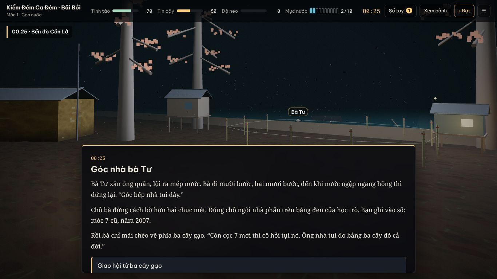
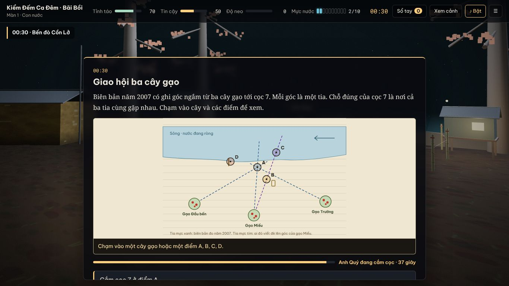

# Kiểm Đếm Ca Đêm · Mùa 2: Phiếu Bàn Giao

Truyện tương tác kinh dị tâm lý 3D bằng tiếng Việt, chơi trên trình duyệt. Mùa 2 của [Kiểm Đếm Ca Đêm · Nhà B4](https://kiemdem.hlvsuckhoe.com/).

**Chơi tại:** https://kiemdem2.hlvsuckhoe.com/

Một năm sau đêm ở nhà B4, Thục Anh về làm kiểm đếm viên của Trung tâm Phát triển quỹ đất tỉnh Hòa Giang. Bốn khu đất sắp đổi chủ, bốn ca đêm kiểm đếm cuối cùng. Ở cả bốn nơi, trên những biên bản cũ, cùng một chữ ký lạ: *Người giữ sổ*.

| Tập | Tên | Trạng thái |
|---|---|---|
| 1 | Bãi Bồi: làng ven sông đêm cuối trước khi di dời, đất đi theo con nước | Đang viết · Màn 1 ✓ |
| 2 | Chợ Sớm | Sắp ra mắt |
| 3 | Ca Ba | Sắp ra mắt |
| 4 | Con Dấu | Sắp ra mắt |




## Chạy thử trên máy
Mở bằng một máy chủ tĩnh bất kỳ (trình duyệt chặn nạp script khi mở file trực tiếp):
```
python3 -m http.server 8000
# mở http://localhost:8000/        (menu mùa)
# hoặc http://localhost:8000/?tap=1 (thẳng vào Tập 1)
```

## Kiểm tra truyện
```
node tools/check.js tap-1/story-act1.js                          # duyệt mọi nhánh
node tools/check.js tap-1/story-act1.js --profile=m1_ghi_su_that # giả lập Mã hồ sơ Mùa 1
node tools/check.js tap-1/story-act1.js --story                  # chế độ đọc truyện
node tools/export.js tap-1/story-act1.js > docs/tap-1/kich-ban-man-1-xuat.md
```

## Cấu trúc
- `engine/`: engine dùng chung cả mùa (truyện, âm thanh, bộ dựng 3D, thẻ kết thúc, Mã hồ sơ).
- `tap-N/`: dữ liệu truyện và không gian 3D của từng tập.
- `config.js`: thông tin tác giả và danh sách tập.
- `docs/`: kế hoạch mùa, kịch bản từng màn, phiếu bàn giao cho phiên làm việc sau.

## Ghi công
Tác giả: Nguyễn Đức Dũng. Kịch bản và lập trình thực hiện cùng Claude (Anthropic). Đồ họa 3D: Three.js (MIT). Font: Be Vietnam Pro, Noto Serif, Roboto Mono (SIL OFL), tự host.

Mọi nhân vật, địa danh và sự kiện đều hư cấu.
